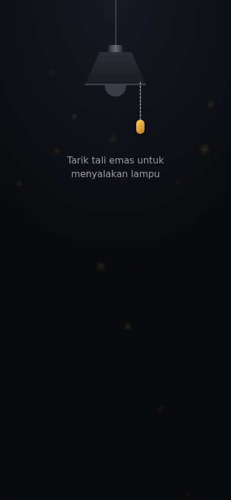
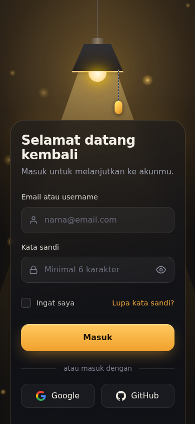
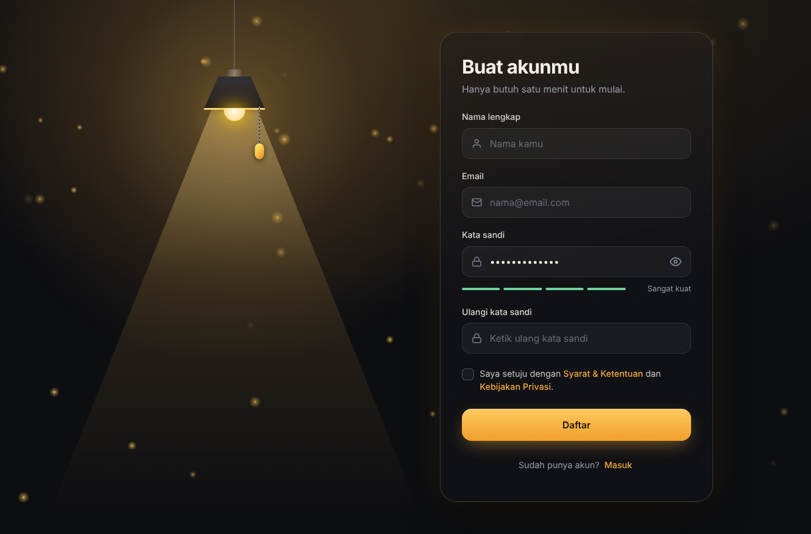
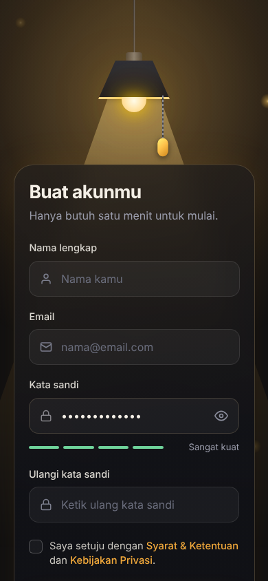
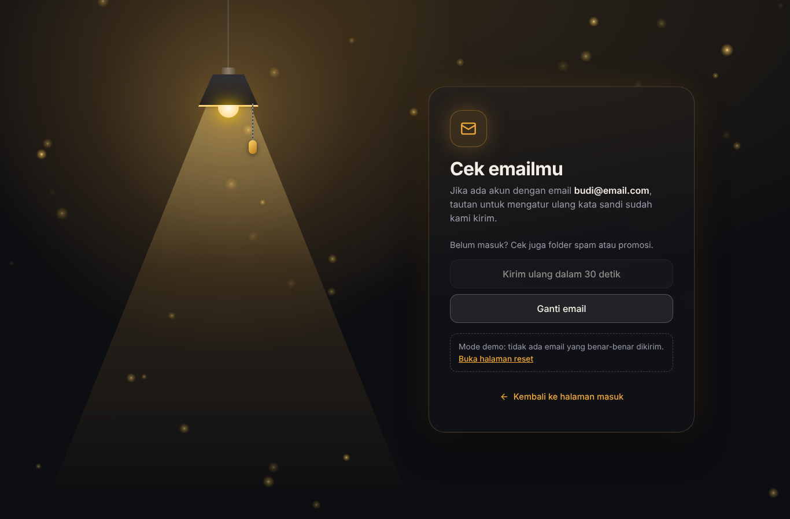
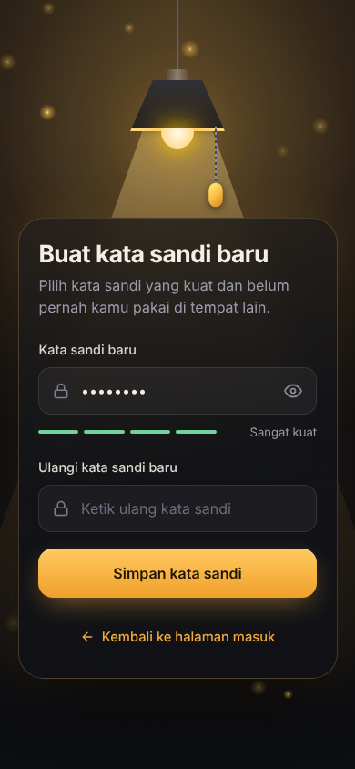

<div align="center">


# Lamp Login

**Tarik tali lampunya. Ruangan menyala. Form login muncul.**

Halaman login interaktif dengan lampu gantung, sinar, dan kunang-kunang.
HTML, CSS, dan JavaScript murni tanpa library, dan nyaman dipakai di HP.

[](https://chr5tt.github.io/Lamp-Login/)

[](https://developer.mozilla.org/en-US/docs/Web/HTML) 
[](https://developer.mozilla.org/en-US/docs/Web/CSS)
[](https://developer.mozilla.org/en-US/docs/Web/JavaScript)


<br>


</div>

---

## Tampilan

<div align="center">

| Lampu mati (HP) | Lampu menyala (HP) |
|:---:|:---:|
|  |  |

<br>

| Halaman daftar (desktop) | Halaman daftar (HP) |
|:---:|:---:|
|  |  |

<br>

| Lupa kata sandi (desktop) | Kata sandi baru (HP) |
|:---:|:---:|
|  |  |

</div>

## Fitur

- **Lampu interaktif.** Tarik tali emas, lampu berayun, sinar jatuh ke bawah, dan form muncul.
- **Responsif.** Lampu di tengah atas pada HP, dua kolom pada layar lebar dan HP landscape.
- **Kunang-kunang di canvas.** Redup saat gelap dan terang saat lampu menyala. Ringan, tajam di layar retina, dan berhenti saat tab tidak aktif.
- **Halaman masuk, daftar, lupa kata sandi, dan reset** dengan gaya yang sama. Status lampu terbawa saat pindah halaman, jadi kalau lampu sudah menyala di halaman masuk, halaman daftar langsung terang.
- **Form yang rapi.** Validasi per kolom, tombol lihat kata sandi, status loading, dan notifikasi.
- **Indikator kekuatan kata sandi** (lemah sampai sangat kuat), cek kecocokan sandi, dan persetujuan syarat di halaman daftar.
- **Alur lupa kata sandi lengkap.** Kirim tautan reset, layar konfirmasi "Cek emailmu" (pesan netral agar alamat email tidak bisa ditebak), jeda 30 detik untuk kirim ulang, lalu halaman buat kata sandi baru.
- **Lampu menempel di desktop** saat form lebih tinggi dari layar, jadi tali tetap bisa dijangkau.
- **Suara klik** dibuat dengan Web Audio API, jadi tidak perlu file audio.
- **Ramah akses.** Tali bisa dipakai lewat keyboard dan pembaca layar, fokus terlihat jelas, dan mengikuti pengaturan *kurangi gerakan* di perangkat.
- **Tanpa dependensi.** Tidak ada Tailwind, FontAwesome, atau framework. Ikon inline dan font punya fallback, jadi jalan offline.

## Coba sekarang

**Online:** buka **[chr5tt.github.io/Lamp-Login](https://chr5tt.github.io/Lamp-Login/)**

**Lokal:**

```bash
git clone https://github.com/chr5tt/Lamp-Login.git
cd Lamp-Login
# buka index.html di browser, atau jalankan server lokal:
npx serve .
```

## Struktur proyek

```
Lamp-Login/
├── index.html            Halaman masuk
├── register.html         Halaman daftar
├── forgot.html           Halaman lupa kata sandi
├── reset.html            Halaman buat kata sandi baru
├── css/
│   └── style.css         Semua gaya (token warna di :root)
├── js/
│   ├── lamp.js           Lampu, tali, suara klik, ingat status lampu
│   ├── fireflies.js      Animasi kunang-kunang
│   ├── toast.js          Notifikasi bersama (LampToast.show)
│   ├── password.js       Indikator kekuatan kata sandi (bersama)
│   ├── form.js           Validasi form masuk
│   ├── register.js       Validasi form daftar
│   ├── forgot.js         Kirim tautan reset + jeda kirim ulang
│   └── reset.js          Validasi kata sandi baru
└── assets/
    ├── favicon.svg
    ├── social-preview.png
    └── screenshots/
```

## Kustomisasi

Ubah warna lewat variabel di bagian `:root` pada `css/style.css`:

| Variabel | Fungsi | Bawaan |
|---|---|---|
| `--amber` | Warna aksen (tombol, fokus, tali) | `#f2a93b` |
| `--bulb` | Warna cahaya bohlam | `#ffd98a` |
| `--ink` | Warna latar ruangan gelap | `#08090c` |
| `--danger` | Warna pesan error | `#ff8f7e` |

Mau tali atau sinar lebih panjang, atau kunang-kunang lebih banyak? Lihat `--wire` di CSS dan angka `count` di `js/fireflies.js`.

## Sambungkan ke server

Form saat ini hanya simulasi. Ganti blok `setTimeout` di `js/form.js` dengan request sungguhan:

```js
const res = await fetch('/api/login', {
  method: 'POST',
  headers: { 'Content-Type': 'application/json' },
  body: JSON.stringify({ identity: identity.value, password: password.value })
});
if (!res.ok) { showToast('Email atau kata sandi salah.', 'error'); return; }
showToast('Berhasil masuk.');
```
Untuk halaman daftar, ganti blok `setTimeout` di `js/register.js` dengan `fetch('/api register', ...)` dengan cara yang sama.

### Alur lupa kata sandi di server

1. `forgot.html` mengirim email ke endpoint, misalnya `POST /api/forgot-password`. Server membuat token acak sekali pakai dengan masa berlaku singkat, lalu mengirim tautan `https://situsmu/reset.html?token=...` lewat email.
2. Server **selalu membalas sukses**, baik email terdaftar maupun tidak. Ini mencegah orang menebak email mana yang punya akun (halaman ini sudah memakai kalimat netral untuk itu).
3. `reset.html` membaca `token` dari URL dan mengirimnya bersama kata sandi baru ke server. Server yang memeriksa token (valid, belum kedaluwarsa, belum dipakai).
4. Hapus blok `.demo-note` di `forgot.html`. Itu hanya pintasan demo ke halaman reset.

> Jangan simpan atau cek kata sandi di sisi browser. Validasi sebenarnya harus selalu dilakukan di server.

## Deploy ke GitHub Pages

1. Pastikan `index.html` ada di **root** repo (bukan di dalam subfolder).
2. Buka **Settings → Pages**, pilih branch `main` dan folder `/ (root)`, lalu **Save**.
3. Situs tersedia di `https://<username>.github.io/<nama-repo>/`.

## Rencana pengembangan

- [ ] Tombol mode terang/gelap
- [ ] Tombol bisu untuk suara klik
- [x] Halaman daftar dengan gaya yang sama
- [x] Halaman lupa kata sandi dan reset
- [ ] Pilihan warna cahaya lampu (hangat, putih, biru)

## Dukungan browser

Chrome, Edge, Firefox, dan Safari versi terbaru (desktop dan mobile).

---

<div align="center">

Dibuat oleh [@chr5tt](https://github.com/chr5tt). Kalau suka, kasih bintang di repo ini.

</div>
